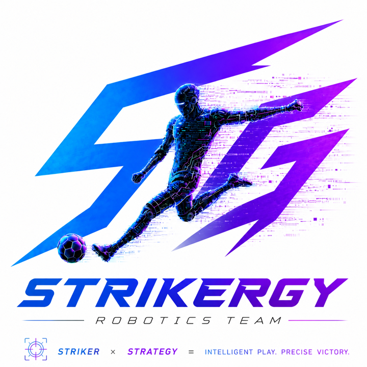
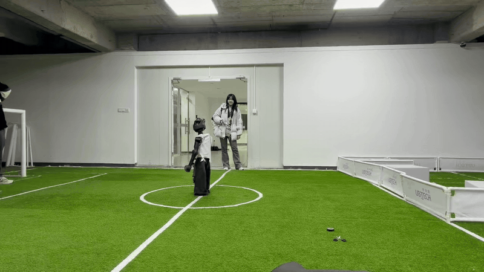
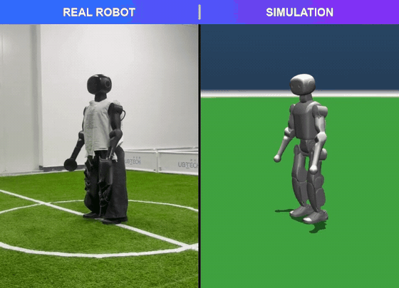
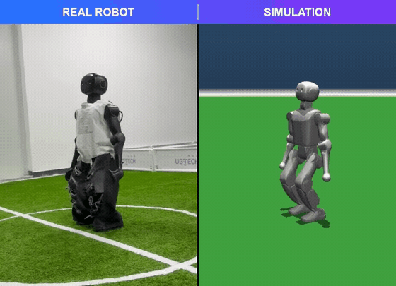
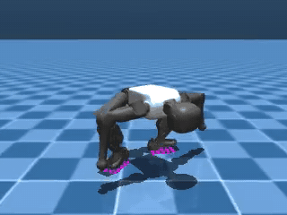
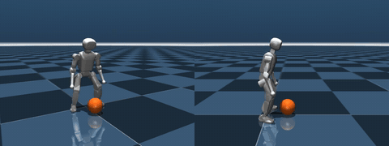
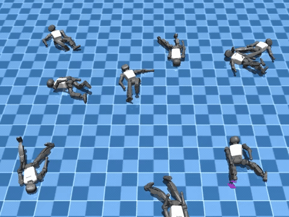
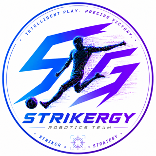
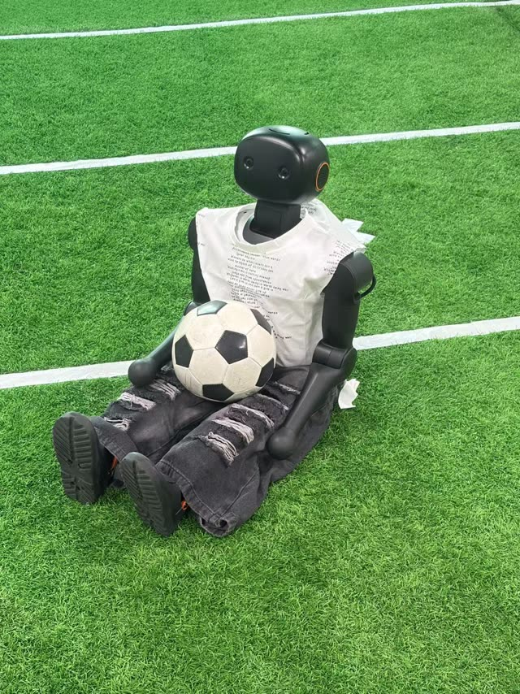

<div align="center">

<picture>
  <source media="(prefers-color-scheme: dark)" srcset="assets/brand/logo_dark.png">
  
</picture>

# K1 FaithFlip · 信仰之跃

**A standing backflip for the Booster K1, running on the real robot.**

<sub><i>Striker × Strategy — Intelligent play. Precise victory.</i></sub>

<p>
  
  
  
  
  
</p>

The K1 stands still, flips backwards through 360°, lands, stands back up and keeps going.

<table><tr>
<td align="center"><b>1</b><br><sub>person</sub></td>
<td align="center"><b>1</b><br><sub>week</sub></td>
<td align="center"><b>1</b><br><sub>AI</sub></td>
<td align="center"><b>2</b><br><sub>landings, both on the real robot</sub></td>
</tr></table>


</div>

## 🎬 Demo

<div align="center">
<br>
<b>On the real pitch</b> · <a href="assets/real_robot_demo.mp4">mp4</a>
</div>

<br>

<table>
<tr>
<td align="center" width="50%">
<br>
<b>Hero landing: real robot (left) vs. simulation (right)</b><br>
<sub>Same phone-camera viewpoint · <a href="assets/faithflip_real_vs_sim.mp4">mp4</a></sub>
</td>
<td align="center" width="50%">
<br>
<b>Standard landing: real robot (left) vs. simulation (right)</b><br>
<sub>Same phone-camera viewpoint · <a href="assets/standard_real_vs_sim.mp4">mp4</a></sub>
</td>
</tr>
</table>


---

## 📦 Models

| | **Hero** `models/hero` | **Standard** `models/standard` |
|---|---|---|
| Landing | Superhero pose (right knee and hand down, left arm back), then stands up | Both feet, then stands up |
| Real robot | ✅ Flipped, landed, stood up | ✅ Flipped, landed, stood up |

---

## 🚀 Deployment

The task plugs into Booster's official deployment framework, [booster_deploy](https://github.com/BoosterRobotics/booster_deploy).

### 0. Before you start ⚠️

> [!IMPORTANT]
> **Battery must be above 60 %.** With a lower battery the robot does not rotate far enough and lands on its back or side. Charge first, check again before every attempt.

> [!WARNING]
> A backflip is a high-risk motion.
> - Clear **at least 2 m** around the robot, especially **behind** it (it travels backwards).
> - Use flat, firm ground: artificial turf, carpet or a gym mat. Do not use slippery floors.
> - Keep a person next to the remote, ready to press **B (damping)**.
> - Run the MuJoCo preview first (step 2).
> - Let the motors rest between attempts.

### 1. Install

```bash
# on your PC and on the robot
git clone https://github.com/BoosterRobotics/booster_deploy.git
git clone https://github.com/Liuxiang-hub/Strikergy-K1-FaithFlip.git

# add the task, the models and the preview script to booster_deploy
cp -r Strikergy-K1-FaithFlip/deploy/tasks/k1_backflip booster_deploy/tasks/
cp -r Strikergy-K1-FaithFlip/models                   booster_deploy/tasks/k1_backflip/
cp    Strikergy-K1-FaithFlip/deploy/scripts/*.py      booster_deploy/scripts/

cd booster_deploy
python3 -m venv .venv && source .venv/bin/activate
python -m pip install -r requirements.txt      # includes onnxruntime
python scripts/deploy.py --list                 # k1_backflip should be listed
```

For the MuJoCo preview you also need [booster_assets](https://github.com/BoosterRobotics/booster_assets) (see the booster_deploy README).

### 2. Preview in MuJoCo

```bash
python scripts/preview_backflip.py --model hero                 # prints rotation and whether it lands standing
python scripts/preview_backflip.py --model standard --video standard.mp4
```

It prints whether the robot flips and lands standing. Use this script rather than `deploy.py --mujoco` for the preview.

### 3. Run on the real robot

```bash
# on the robot (Booster firmware as required by booster_deploy)
cd booster_deploy && source .venv/bin/activate
source /opt/booster/BoosterRos2Interface/install/setup.bash

K1_FLIP_MODEL=hero python scripts/deploy.py --task k1_backflip
```

### 4. Controls

| Step | Remote | What the robot does |
|---|---|---|
| 1 | **X** | Prepares: eases into the standing pose (about 4 s) |
| 2 | **A** | The policy takes over and **balances on its own**, holding the start of the motion |
| 3 | **D-pad Up** | Go: takeoff about **1.3 s** later, flips, lands, stands up |
| ✋ | **B** | Damping (emergency stop) at any time |

**No D-pad signal?** Start with `K1_FLIP_GO_AFTER=<seconds>`: the flip then starts automatically after that many seconds of balancing.

| Variable | Default | Meaning |
|---|---|---|
| `K1_FLIP_MODEL` | `hero` | `hero` or `standard` |
| `K1_FLIP_GO_AFTER` | `-1` | Seconds of balancing before an automatic go; `-1` waits for D-pad Up |

---

## 🗂️ Repository layout

```
Strikergy-K1-FaithFlip/
├── models/
│   ├── hero/        hero landing
│   └── standard/    standard landing
├── deploy/tasks/k1_backflip/   booster_deploy task
├── deploy/scripts/             MuJoCo preview
└── assets/          demo GIFs and videos · brand/ team logos
```

---

## 🔜 Coming soon

More K1 skills from the same pipeline, **to be open-sourced next**:

<table>
<tr>
<td align="center" width="33%">
<br>
<b>Quadruped crawl</b><br>
<sub>Torso down, crawls in every direction and turns · <a href="assets/coming_soon/crawl.mp4">mp4</a></sub>
</td>
<td align="center" width="33%">
<br>
<b>Ball pick-up &amp; throw</b><br>
<sub>Squats, grabs the ball, lifts it overhead and throws · <a href="assets/coming_soon/ball_pick_and_throw.mp4">mp4</a></sub>
</td>
<td align="center" width="33%">
<br>
<b>Fall recovery</b><br>
<sub>Nine robots fall at random and all get back up · <a href="assets/coming_soon/fall_recovery.mp4">mp4</a></sub>
</td>
</tr>
</table>

<sub>Simulation previews. ⭐ Star the repo to follow the release.</sub>

## 👥 About Strikergy

<table>
<tr>
<td width="34%" align="center">
<picture>
  <source media="(prefers-color-scheme: dark)" srcset="assets/brand/badge_dark.png">
  
</picture>
</td>
<td>

**Strikergy** (*Striker × Strategy*) is a robotics team founded in **October 2026**, with **three core members**, from **Huazhong University of Science and Technology (HUST), China**.

FaithFlip was trained by **one person, in one week, with one AI**.

We train humanoid soccer skills for the Booster K1 (running, kicking, getting up and, yes, backflips) and bring every one of them to the real robot.

</td>
<td width="30%" align="center">
<br>
<sub>Our K1, off duty</sub>
</td>
</tr>
</table>

## 📜 License

| What | License | In short |
|---|---|---|
| Code and models (`deploy/`, `models/`) | [PolyForm Noncommercial 1.0.0](LICENSE) | Free for personal, hobby, study, research and other non-commercial use |
| Videos and GIFs (`assets/`) | [CC BY-NC 4.0](assets/LICENSE) | Free to share and adapt non-commercially, with attribution |
| Team name, logos and photo (`assets/brand/`) | All rights reserved | Not covered by the licenses above |

**Commercial use needs a separate commercial license.** Contact us through GitHub: [@Liuxiang-hub](https://github.com/Liuxiang-hub) (or open an issue in this repository).

Third-party components keep their own licenses, e.g. [booster_deploy](https://github.com/BoosterRobotics/booster_deploy) (Apache-2.0), which this task plugs into.

## 🙏 Acknowledgements

[Booster Robotics](https://github.com/BoosterRobotics) (K1, booster_deploy, booster_assets) ·
[CMU Graphics Lab Motion Capture Database](http://mocap.cs.cmu.edu/)

<div align="center">
<br>
<sub>Made with ❤️ and many falls by <b>Strikergy</b> · HUST, China</sub>
</div>
